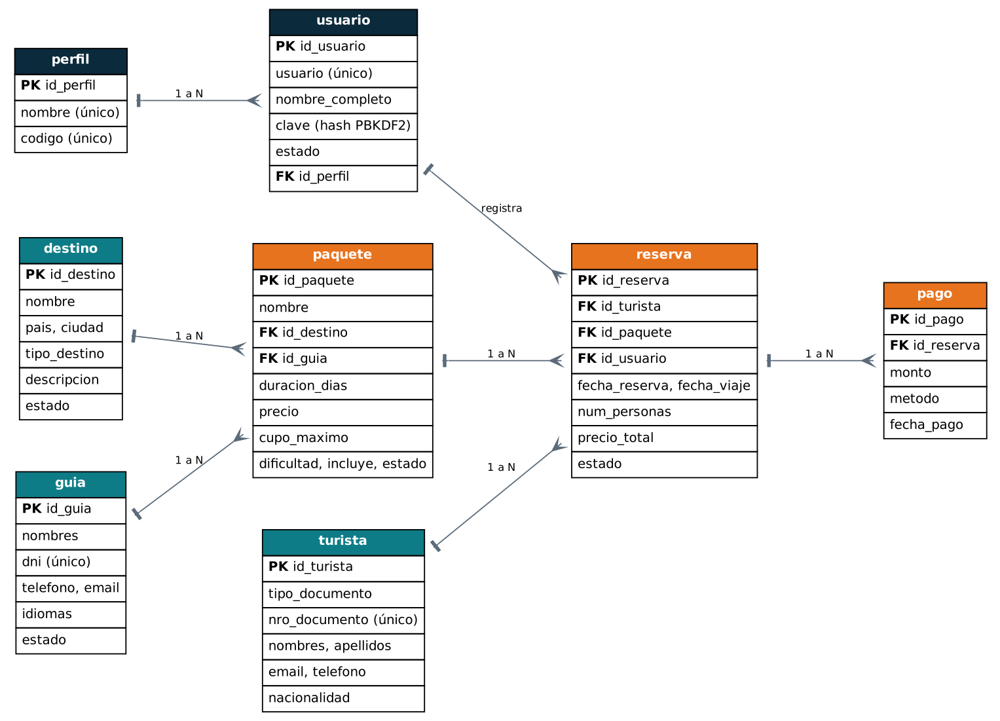

# Modelo de datos

Son ocho tablas. `perfil` y `usuario` controlan el acceso. `destino`, `guia` y `paquete` forman el catálogo. `turista`, `reserva` y `pago` guardan la operación diaria.

Relaciones:

- Un perfil tiene muchos usuarios.
- Un destino tiene muchos paquetes, y un guía también.
- Un turista hace muchas reservas, y un paquete recibe muchas.
- Cada reserva la registra un usuario.
- Una reserva tiene muchos pagos.

Reglas que protege la propia base, además del código: claves foráneas, valores únicos (usuario, DNI del guía, documento del turista, nombre y código del perfil) y restricciones CHECK que impiden precios, cupos, personas o montos menores o iguales a cero y estados fuera de la lista.

El dinero se guarda como `DECIMAL(10,2)` y en Java como `BigDecimal`, porque `double` acumula errores de redondeo.

## Cómo hacerlo en SQL Power Architect

El script `schema_turismo.sql` tiene las tablas completas. Hay dos caminos:

1. Crear un proyecto nuevo, agregar las ocho tablas con sus columnas y relaciones copiando el diagrama de arriba, y usar la opción de generar el DDL para comparar con el script.
2. Ejecutar la aplicación una vez para que se cree `data/systurismo.mv.db`, y en Power Architect conectarse a esa base con el driver de H2 (`jdbc:h2:file:<ruta>/data/systurismo`, usuario `sa`, sin clave) y usar la opción de ingeniería inversa.

El docente pide modelar la base en Power Architect y generar las tablas a partir del modelo. Guarde el archivo `.architect` en `docs/` y súbalo al repositorio.
